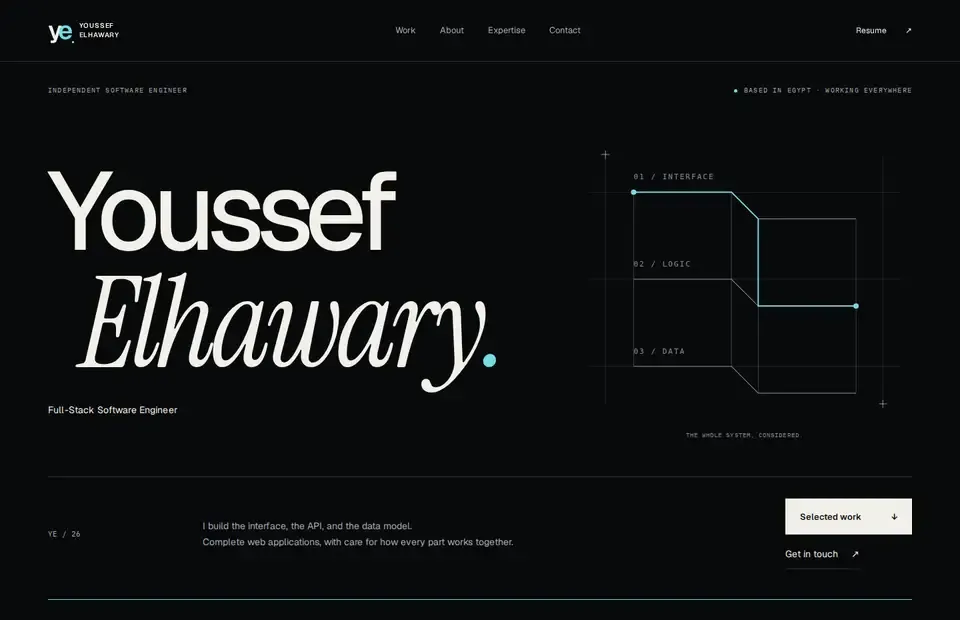
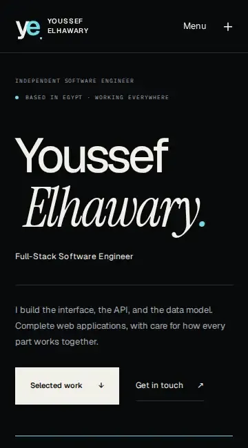

# Editorial design system

Architectural typography and a recurring interface–logic–data diagram connect the visual identity to the engineering work. The homepage introduces the engineer before asking the reader to examine three substantial projects.

## Palette and type

| Token    | Value     | Use                                 |
| -------- | --------- | ----------------------------------- |
| Obsidian | #090A0B   | Main canvas                         |
| Charcoal | #141619   | About section and mobile disclosure |
| Ivory    | #F2F0E9   | Primary text and buttons            |
| Silver   | #A6ADB4   | Supporting prose                    |
| Ice cyan | #70DAE8   | Focus, selected text, diagram route |
| Border   | #FFFFFF26 | Dividing rules                      |

Geist is the interface and body face. Instrument Serif italic gives the surname and selected phrases an editorial counterpoint. IBM Plex Mono is reserved for metadata. Fonts are self-hosted and OFL-licensed; only Geist is preloaded. Display sizes use clamp(), with separate mobile compositions.

## Composition

The shell caps at 1560px, with gutters from 22px to 88px. A 12-column work layout gives the LMS a full-width architectural diagram, Safaga a larger map composition, and CareerBridge a narrower, offset workflow composition. Below 700px the project grid becomes a single column. About, expertise, experience, and contact use distinct layouts rather than repeating cards.

Application imagery is authentic. Safaga is a real capture; the other two covers explicitly say implementation diagram. Project colors distinguish subjects without changing the site's predominantly dark identity.

## Interaction and access

The structural accent line uses Motion's mini Web Animations entry point. CSS handles hover and focus feedback. No content waits for animation. Reduced motion disables transitions and the finite entrance animation, including when the preference changes while the page is open.

Navigation uses real links and a native details/summary disclosure on mobile. The disclosure works without JavaScript; Escape and close-on-navigation are enhancements. Focus indicators, a skip link, semantic headings, and meaningful text links support keyboard and assistive technology use. Route prefetching is disabled to keep initial loading lean.

## Actual screenshot previews

These excerpts were captured from the built site in Chromium CI, not generated mockups. Full-page captures for all tested sizes are retained in the workflow artifacts.

[All page headers on mobile](previews/pages-360.webp) · [All page headers on desktop](previews/pages-1440.webp)
